# Оригинальные спрайты ванильного оружия

Эта папка — быстрый референс по ванильным спрайтам оружия, которое перерабатывают моды в этом репозитории. Она лежит вне папок самих модов, поэтому в `.tmod` не попадает.

Имена файлов и размеры сверены с карточками файлов на Terraria Wiki (wiki.gg). В последнем столбце — ссылка на карточку исходного файла.

## FrostMelee

| Спрайт | Файл | Оружие | ItemID | Размер | Где оружие включено в мод | Wiki.gg |
|---|---|---|---:|---:|---|---|
| 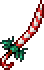 | `Candy_Cane_Sword.png` | Карамельный меч / Candy Cane Sword | 1909 | 44×70 | `FrostMelee/Content/Weapons/SwordTypes.cs` | [Файл](https://terraria.wiki.gg/wiki/File:Candy_Cane_Sword.png) |
| 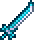 | `Ice_Blade.png` | Ледяной клинок / Ice Blade | 724 | 34×40 | `FrostMelee/Content/Weapons/SwordTypes.cs` | [Файл](https://terraria.wiki.gg/wiki/File:Ice_Blade.png) |
|  | `Ice_Boomerang.png` | Ледяной бумеранг / Ice Boomerang | 670 | 18×32 | `FrostMelee/Content/Weapons/BoomerangPlayer.cs` | [Файл](https://terraria.wiki.gg/wiki/File:Ice_Boomerang.png) |
| 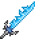 | `Frostbrand.png` | Морозный клинок / Frostbrand | 676 | 52×58 | `FrostMelee/Content/Weapons/SwordTypes.cs` | [Файл](https://terraria.wiki.gg/wiki/File:Frostbrand.png) |
| 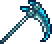 | `Ice_Sickle.png` | Ice Sickle (в моде — Замороженное копьё) | 1306 | 52×44 | `FrostMelee/Content/SickleTypes.cs` | [Файл](https://terraria.wiki.gg/wiki/File:Ice_Sickle.png) |
|  | `Amarok.png` | Амарок / Amarok | 3289 | 30×26 | `FrostMelee/Content/Yoyo/AmarokGlobalItem.cs` | [Файл](https://terraria.wiki.gg/wiki/File:Amarok.png) |
|  | `Christmas_Tree_Sword.png` | Меч из ёлки / Christmas Tree Sword | 1928 | 60×60 | `FrostMelee/Content/Weapons/SwordTypes.cs` | [Файл](https://terraria.wiki.gg/wiki/File:Christmas_Tree_Sword.png) |
| 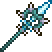 | `North_Pole.png` | Северный полюс / North Pole (уникальные эффекты реализованы, нужны сборка и игровой тест) | 1947 | 52×52 | `FrostMelee/Content/Weapons/NorthPoleGlobalItem.cs` | [Файл](https://terraria.wiki.gg/wiki/File:North_Pole.png) |

## WoodSwordsOverhaul

| Спрайт | Файл | Оружие | ItemID | Размер | Где оружие включено в мод | Wiki.gg |
|---|---|---|---:|---:|---|---|
| 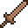 | `Wooden_Sword.png` | Деревянный меч / Wooden Sword | 24 | 32×32 | `WoodSwordsOverhaul/Content/StickTypes.cs` | [Файл](https://terraria.wiki.gg/wiki/File:Wooden_Sword.png) |
| 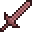 | `Rich_Mahogany_Sword.png` | Меч из красного дерева / Rich Mahogany Sword | 656 | 32×32 | `WoodSwordsOverhaul/Content/StickTypes.cs` | [Файл](https://terraria.wiki.gg/wiki/File:Rich_Mahogany_Sword.png) |
| 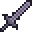 | `Ebonwood_Sword.png` | Меч из эбонитового дерева / Ebonwood Sword | 653 | 32×32 | `WoodSwordsOverhaul/Content/StickTypes.cs` | [Файл](https://terraria.wiki.gg/wiki/File:Ebonwood_Sword.png) |
|  | `Shadewood_Sword.png` | Меч из мрачного дерева / Shadewood Sword | 921 | 32×32 | `WoodSwordsOverhaul/Content/StickTypes.cs` | [Файл](https://terraria.wiki.gg/wiki/File:Shadewood_Sword.png) |
| 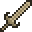 | `Pearlwood_Sword.png` | Меч из жемчужного дерева / Pearlwood Sword | 659 | 32×32 | `WoodSwordsOverhaul/Content/StickTypes.cs` | [Файл](https://terraria.wiki.gg/wiki/File:Pearlwood_Sword.png) |
| 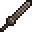 | `Boreal_Wood_Sword.png` | Меч из северного дерева / Boreal Wood Sword | 2745 | 32×32 | `WoodSwordsOverhaul/Content/StickTypes.cs` | [Файл](https://terraria.wiki.gg/wiki/File:Boreal_Wood_Sword.png) |
| 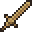 | `Palm_Wood_Sword.png` | Меч из пальмового дерева / Palm Wood Sword | 2517 | 32×32 | `WoodSwordsOverhaul/Content/StickTypes.cs` | [Файл](https://terraria.wiki.gg/wiki/File:Palm_Wood_Sword.png) |
| 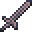 | `Ash_Wood_Sword.png` | Меч из пепельного дерева / Ash Wood Sword | 5284 | 32×32 | `WoodSwordsOverhaul/Content/StickTypes.cs` | [Файл](https://terraria.wiki.gg/wiki/File:Ash_Wood_Sword.png) |
| 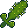 | `Cactus_Sword.png` | Кактусовый меч / Cactus Sword | 881 | 48×48 | `WoodSwordsOverhaul/Content/StickTypes.cs` | [Файл](https://terraria.wiki.gg/wiki/File:Cactus_Sword.png) |

## ReaperMelee

| Спрайт | Файл | Оружие | ItemID | Размер | Где оружие включено в мод | Wiki.gg |
|---|---|---|---:|---:|---|---|
| 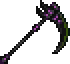 | `Death_Sickle.png` | Коса смерти / Death Sickle | 1327 | 70×64 | `ReaperMelee/Content/SickleTypes.cs` | [Файл](https://terraria.wiki.gg/wiki/File:Death_Sickle.png) |
